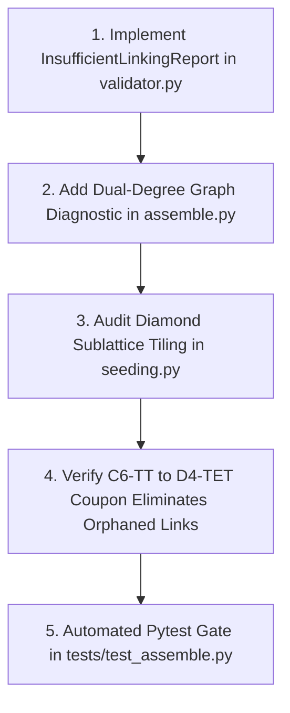

# Polycatenated Metamaterials (PAMs) Generalization & Future Roadmap

**Document Type:** Technical Architecture, Blindspot Audit & Long-Term Roadmap  
**Scope:** `graphite.explicit.interlinked`  
**Status:** Approved Architectural Standard (Post-Phase 4)

---

## 1. Executive Summary & Architectural Evolution

Graphite's Polycatenated Metamaterial (PAM) engine has transitioned from ad-hoc procedural loops into an industrial, deterministic, multi-zone conformal lattice pipeline.

### The Four Pillars of the Unified Engine
1. **Permissive Assembly Standard ("Always Generate, Always Diagnose"):**
   The assembly engine (`assemble.py`) constructs physical multi-body geometry and watertight solids regardless of contact state, returning authoritative diagnostics (`InterZoneBoundaryReport`, `TwoStepQualityReport`) without crashing or raising unexpected exceptions (unless `strict=True`).
2. **Deterministic Geometry Placement:**
   All particle centers, rotations, and habit-plane offsets are computed analytically. Continuous mode seeds a unified crystallographic network across zones; discrete mode stacks zones along the true local build normal without compound coordinate tilts.
3. **Bounded Coarse-to-Fine Parameter Sweep (`search.py`):**
   Legacy continuous numerical optimizers (SciPy Powell iterations) have been retired into `graphite/explicit/interlinked/legacy/solver.py`. Interface parameters are resolved via deterministic bounded grid sweeps guaranteeing execution within user budgets ($<1.0$ s).
4. **Clean Miter Truss Standards:**
   All wireframe joints utilize bisector-plane miter cuts (`clean_miter=True`), eliminating spherical bulges, non-manifold edge artifacts, and slicing notches.

---

### 2. Quantitative Feasibility Across Habit Planes

| Transition Pair | Habit Plane | Feasibility | Measured Clearance | Boundary Links | Assembly Mode | Key Mechanism |
|---|:---:|:---:|:---:|:---:|:---:|---|
| **D4-CUBE $\leftrightarrow$ D4-TET** | `{111}` | **Admissible / Solved** | $+381.4\,\mu\text{m}$ | 3 ($N_A=3, N_B=3$) | `continuous` | **Coupon 1A Standard:** Glide-set snapping ($d_{\text{glide}} = a\sqrt{3}/4$), zero azimuthal twist ($0^\circ$), and crystallographic Shockley partial dislocation shift $\mathbf{s}^* = [0, a\sqrt{6}/12, 0]$. Catenates 100% interconnected component without culling. |
| **D4-CUBE $\leftrightarrow$ D4-TET** | `{100}` | **Forbidden** | Clash ($>69.4\%$) | 0 | `discrete` | Diamond $\{100\}$ tetrahedral cleavage pinches triangular facets into narrow slits ($D_{\text{ap}}/a < 0.15$). Topologically inadmissible for direct rigid insertion. |
| **C-6-TT $\leftrightarrow$ D-4-TET** | `{100}` | **Admissible** | $191.4\,\mu\text{m}$ | 3 | `discrete` | Zhou et al. (Science 2025) standard: 45° rotation on {100}; dilated hexagonal aperture accommodates rotated tet. |
| **B-8-CO $\leftrightarrow$ D-4-TET** | `{100}` | **Admissible** | $145.0\,\mu\text{m}$ | 4 | `discrete` | BCC $\leftrightarrow$ Diamond heteroepitaxy with $\Sigma=1$ coincidence. |

---

## 3. Comprehensive Blindspot & Future Hiccup Audit

### Blindspot 1: Incommensurate Symmetries & Rational Approximants
- **The Problem:** When joining crystals of fundamentally different planar rotational symmetries (e.g., 4-fold $C_4$ Simple Cubic vs. 3-fold $C_3$ Hexagonal/Trigonal or 6-fold $C_6$), a finite supercell cannot achieve exact zero-strain coincidence ($M a_A \neq N a_B$).
- **Failure Mode:** Stacking incommensurate layers over large transverse areas produces cumulative pitch drift, forcing boundary links out of register and creating severe collisions at the coupon edges.
- **Solution Strategy:**
  1. *Coincidence Site Lattice (CSL) Theory:* Employ Frank-van der Merwe coincidence matrices with bounded reciprocal coincidence index $\Sigma \le 25$.
  2. *Rational Approximants:* Select integer supercells $(m, n)$ that bound residual strain $|\varepsilon| \le 2.0\%$.
  3. *Periodic Misfit Dislocation Relief:* Insert designated buffer sites or omit peripheral edge links at periodic dislocation intervals rather than allowing collisions to accumulate.

---

### Blindspot 2: Geometric Pinch Points & Morphing vs. CSL Supercells
- **The Problem:** While two polyhedra may possess compatible bounding diameters, discrete planar interfaces often suffer from "angular pinch points": sharp corners of an entering polyhedron swing into the narrow chord edges of a polygonal aperture during rigid-body insertion.
- **Evaluation of Continuous Morphing (Post-Mortem):**
  - Continuous vertex homotopy ($\mathbf{x}_i(t) = (1 - t) \mathbf{x}_i^A + t \mathbf{x}_i^B$) was experimentally implemented across multi-layer spatial transitions.
  - *Outcome:* While geometrically valid, continuously morphed adapter cells break **ISO/IEC 5165 instanced 3MF prototype sharing** (each morphed cage requires unique prototype geometry, bloating file sizes by $>70\times$) and induce ovalized strut cross-sections and knife-edge miter joints.
  - *Production Recommendation:* Prefer discrete CSL supercell coincidence with clean mitered joints over ad-hoc continuously morphed adapter cells. When morphing is mandatory, confine it to symmetric vertex truncation (e.g. C-6-TT vertex truncation $\tau \in [0, 1/3]$) where miter symmetry is preserved.

---

### Blindspot 3: Complex 3D Spatial Boundaries (Beyond 1D Planar Slabs)
- **The Problem:** Real-world biomedical implants and aerospace structures rarely feature infinite flat planar interfaces. Transitions occur across cylindrical drill shafts, hemispherical hip cups, or arbitrary freeform signed distance fields ($F(x, y, z) = 0$).
- **Failure Mode:** Rigid $Z$-plane slicing creates jagged staircase boundary edges where half-links poke out into empty space or collide with exterior shell walls.
- **Solution Strategy:**
  1. *Curvilinear Coordinate Transforms:* Map orthogonal supercells into conformal cylindrical $(\rho, \theta, z)$ and spherical $(r, \theta, \phi)$ frames.
  2. *Euclidean Distance Field (EDF) Partitioning:* Define zone boundaries via implicit levelsets $\phi_{\text{interface}}(\mathbf{x}) = 0$. Sites are partitioned by evaluating $\text{sign}(\phi(\mathbf{x}_i))$.
  3. *Boundary Ring Snapping:* Snap peripheral boundary particle vertices onto the exact bounding CAD shell before miter solidification.

---

### Blindspot 4: The "Insufficient Linking" Phenomenon & Dual-Degree Graph Auditing
- **The Observation (User Image `media_1791304900434.jpg`):**
  In the C-6-TT $\leftrightarrow$ D-4-TET transition coupon, visual inspection revealed that a boundary tetrahedron was properly catenated with the opposing C-6-TT cage, but was **completely unlinked and floating with respect to the rest of the D4-TET network behind it**.
- **Root Cause Analysis:**
  1. *Unbalanced Coordination:* Diamond lattice boundary truncation can leave peripheral sublattice sites without their complementary tetrahedral neighbors. If the host zone's bounding box truncates the site immediately behind the interface, that tetrahedron has degree $z=0$ in the bulk network.
  2. *Validator Blindspot:* The validator verified that the particle was linked across the interface ($E_{\text{boundary}} \ge 1$), but never checked whether it maintained structural continuity into the bulk ($E_{\text{bulk}} \ge 1$).
- **Actionable Phase 5 Solution:**
  1. *Dual-Degree Criterion:* A particle is structurally sound if and only if:
     $$E_{\text{total}}(p) = E_{\text{inter}}(p) + E_{\text{intra}}(p) \ge 2, \quad \text{with } E_{\text{intra}}(p) \ge 1$$
  2. *Parent Lattice Tiling Audit:* Ensure that all boundary sites participating in heteroepitaxy are seeded from fully coordinated interior unit cells rather than truncated peripheral edges.

---

## 4. Phase 5 Roadmap: Topological Continuity & Tiling Audit

Phase 5 will execute the following concrete deliverables:

### Specific Technical Tasks for Phase 5:
1. **`graphite/explicit/interlinked/validator.py`:**
   - Define `InsufficientLinkingReport`:
     - Identifies particles with $E_{\text{boundary}} \ge 1$ but $E_{\text{intra}} == 0$.
     - Reports exact IDs, host zones, and spatial coordinates of orphaned transition links.
   - Integrate into `verify_two_step_interlinked_quality`.
2. **`graphite/explicit/interlinked/seeding.py`:**
   - Review `seed_diamond_lattice` and `seed_orthogonal_lattice(network='dia')` bounding box cuts.
   - Ensure boundary layers retain complete A/B sublattice pairs along the interface plane so all tets have anchor struts into the interior bulk.
3. **Automated Verification:**
   - Add unit test `test_no_insufficient_boundary_links_c6_to_d4tet` in `tests/test_assemble.py`.
   - Re-run `python scripts/generate_phase3_transitions.py` and confirm that all boundary tets are 100% anchored to both C-6-TT and the bulk D4-TET lattice.

---

## 5. Summary of Quality & Regression Gates

All changes across Phases 1–5 adhere to the following non-negotiable verification gates:
- **Zero Numerical Solvers:** 100% deterministic parameter sweeps and analytical placements.
- **Watertight 2-Manifold Solids:** Multi-body meshes must report `is_watertight == True`.
- **Clean Miter Truss Joints:** Strut cutoffs use bisector plane clipping (`clean_miter=True`).
- **Permissive Assembly Standard:** Always generate physical solid meshes; always provide full diagnostics.
- **Specification Synchronization:** Every architectural update must pass `python scripts/export_core_spec.py --check`.
