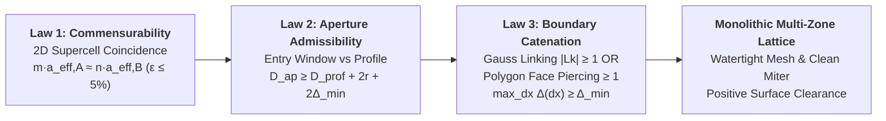

# Polycatenated Architected Materials (PAMs) — Architecture & Implementation Guide

## 1. Overview & Theoretical Framework

Polycatenated Architected Materials (PAMs) are a class of **kinematic 3D metamaterials** constructed from discrete, unbonded polyhedral wireframe cages that are topologically catenated (interlinked) across crystallographic parent networks ([Zhou et al., *Science* 2025](https://doi.org/10.1126/science.adp5092)).

Unlike standard structural lattices (which weld intersecting struts at common node junctions), PAMs maintain a strictly positive surface clearance:
$$\\Delta = d_{\\text{centerline}} - (r_1 + r_2) \\ge \\Delta_{\\min} > 0$$
across all struts. When printed in additive manufacturing (via SLS, SLA, or multi-material jetting), the independent cages move freely without mechanical bonding, giving rise to:
- Non-linear topological kinematics (finite free-play before kinematic locking).
- Giant energy dissipation through inter-cage friction and contact.
- Auxetic negative Poisson's ratios under tensile and compressive loading.

---

## 2. Tripartite Naming Convention (`X-n-abc`)

In accordance with Reticular Chemistry Structure Resource (RCSR) and Zhou et al. (2025), PAM architectures follow the tripartite descriptor **`X-n-abc`**:

| Component | Code | Meaning | Examples |
| :--- | :--- | :--- | :--- |
| **`X`** | Parent Network | The underlying crystallographic graph connecting particle centers | `C` (primitive cubic `pcu`), `D` (diamond `dia`), `S` (shifted cubic `pcu-b`), `J` (planar square cluster) |
| **`n`** | Coordination Number | Number of catenated cage interlocks per particle | $n = 4$ (tetrahedral/square), $n = 6$ (octahedral/cubic), $n = 6/2$ (hybrid primary/secondary) |
| **`abc`** | Particle Geometry | Wireframe polyhedral cage geometry | `TET` (tetrahedron), `TT` (truncated tetrahedron), `OCT` (octahedron), `CO` (cuboctahedron) |

---

## 3. Core 3D Bulk Periodic Topologies

### 3.1 `C-6-TT` (Cubic Truncated Tetrahedral)
- **Crystallographic Network:** Primitive Simple Cubic (`pcu`), coordination $n = 6$.
- **Particle Geometry:** Truncated Tetrahedron (12 vertices, 18 struts).
  - Derived from truncating a regular tetrahedron at $1/3$ edge length.
  - Possesses $T_d$ tetrahedral point-group symmetry.
  - Forms 4 hexagonal faces (normals along $\\langle 1, 1, 1 \\rangle$) and 4 triangular face cutouts (normals along opposite $\\langle 1, 1, 1 \\rangle$).
- **Resolution of 3D Cuboctahedron Frustration:**
  - *Theoretical Paradox:* A standard cuboctahedron (`CO`) with diamond-oriented square faces cannot achieve a relative $45^\\circ$ twist along all three orthogonal Cartesian axes simultaneously using any rigid $SO(3)$ rotation matrix, because orthogonal 3D rotations do not commute. Setting an unrotated or 2-fold rotated cuboctahedron on a simple cubic grid causes strut collisions ($\\Delta = 0.0\\text{ mm}$).
  - *Truncated Tetrahedron Solution:* The Truncated Tetrahedron wireframe presents open hexagonal and triangular window cutouts directly aligned with the neighbor approach vectors. Adjacent unrotated particles interpenetrate through these open windows with **zero solid collisions**.
- **Validated Lattice Parameters:**
  - Unit cell spacing: $a_0 = 1.25 \\times \\text{size}$.
  - Edge length: $L_{\\text{edge}} = \\frac{2}{3} \\times \\text{size}$.
  - For $\\text{size} = 10.0\\text{ mm}$, $a_0 = 12.50\\text{ mm}$, $r = 0.50\\text{ mm}$ (1.0 mm wire):
    - Minimum surface clearance: **$\\Delta = 0.6421\\text{ mm} \\ge 0.30\\text{ mm}$** (exceeds SLA/SLS DFAM requirements).
    - Boolean collision volume: **$0.0\\text{ mm}^3$** across all interacting pairs.

### 3.2 `D-4-TET` (Diamond Tetrahedral)
- **Crystallographic Network:** Diamond (`dia`), coordination $n = 4$.
- **Particle Geometry:** Regular Tetrahedron (4 vertices, 6 struts).
- **Sublattice Parity & Relative Twist:**
  - Diamond sites are partitioned into bipartite sublattices: Sublattice A ($P=0$) and Sublattice B ($P=1$), displaced along $\\langle 1, 1, 1 \\rangle / 4$.
  - Particle A has vertex 0 aligned with $[+1, +1, +1]$.
  - Particle B has vertex 0 aligned with $[-1, -1, -1]$ with a relative $60^\\circ$ twist around the bond axis.
  - Catenation occurs corner-through-face along all 4 tetrahedral coordination vectors.
- **Validated Lattice Parameters:**
  - Bond length: $d \\approx 1.10 \\times L_{\\text{edge}}$ (or calibrated via `calibrate_d4tet_edge_length`).
  - Conventional cell size: $a = \\frac{4d}{\\sqrt{3}}$.
  - Tested: $3 \\times 3 \\times 2$ conventional block (144 particles), $\\Delta \\ge 0.10\\text{ mm} - 0.40\\text{ mm}$.

### 3.3 `J-4-OCT` (Octahedral Planar Cross)
- **Crystallographic Network:** 2D Square-planar grid ($n = 4$).
- **Particle Geometry:** Regular Octahedron (6 vertices, 12 struts).
- **Catenation Mechanism:** Central octahedron connects tip-to-tip with 4 orthogonal neighbors along $\\pm X$ and $\\pm Y$ with a $45^\\circ$ relative bond twist.

### 3.4 `S-6/2-OCT` (Shifted Octahedral Hybrid)
- **Crystallographic Network:** Shifted cubic network (`pcu-b`), hybrid coordination $n = 6$ (primary corner catenation along Cartesian axes) + $n = 2$ (secondary edge catenation along body diagonals).

### 3.5 `J-4-RING` (Diamond Octahedral Six-Ring Cluster PAM)
- **Reference:** Zhou et al., *Science* 387, 269–277 (2025), DOI: 10.1126/science.adr9713.
- **Kinematic Independence:** The 6 constituent rings in each cluster are **discrete, unbonded rigid bodies** (each possessing 6 DOFs), never welded or fused. The fluid-solid duality and non-Newtonian jamming arise directly from contact friction and kinematic free-play among these unbonded tori.
- **Octahedral Cluster Geometry ($O_h$ Symmetry):**
  - **Centers ($c_i$):** Radially offset along the 6 Cartesian semi-axes:
    $$c_{\pm x} = (\pm d_{\text{off}}, 0, 0), \quad c_{\pm y} = (0, \pm d_{\text{off}}, 0), \quad c_{\pm z} = (0, 0, \pm d_{\text{off}})$$
  - **Plane Normals ($n_i$):** Point along the respective offset axis:
    $$n_{\pm x} = (\pm 1, 0, 0), \quad n_{\pm y} = (0, \pm 1, 0), \quad n_{\pm z} = (0, 0, \pm 1)$$
  - **Internal Interlocking:** Because $d_{\text{off}} < R$, orthogonal pairs of tori mutually thread through one another's interior apertures, creating an intrinsically catenated 6-ring "jack" cluster.
  - **Geometric Ratios:** $d_{\text{off}} / R \approx 0.50 - 0.70$, minor-to-major wire ratio $r / R \approx 0.15 - 0.25$ ($d_{\text{wire}} / D_{\text{major}} \approx 0.15 - 0.25$).
- **Lattice Topology & Unit Cell Placement:**
  - **Parent Network:** Diamond cubic (`dia`, space group $Fd\bar{3}m$, No. 227), coordination $n = 4$.
  - **Unit Cell Sites:** 8 cluster origins per conventional cube of parameter $a$:
    - Sublattice A (FCC): $(0, 0, 0), (0, 1/2, 1/2), (1/2, 0, 1/2), (1/2, 1/2, 0)$
    - Sublattice B (FCC shifted by $(1/4, 1/4, 1/4)$): $(1/4, 1/4, 1/4), (1/4, 3/4, 3/4), (3/4, 1/4, 3/4), (3/4, 3/4, 1/4)$
  - **Sublattice Orientation:** All clusters share the **same global orientation** ($R = I$). Because the $O_h$ 6-ring cluster is centrosymmetric ($i \in O_h$), it inherently covers both forward and inverted tetrahedral directions without requiring any bipartite dual twist.
- **Inter-Cluster Catenation & Sizing:**
  - Catenation occurs along the four tetrahedral $\langle 1, 1, 1 \rangle$ bonds ($d_{\text{bond}} = \frac{\sqrt{3}}{4} a$).
  - Overlap condition: $d_{\text{off}} + R > \frac{d_{\text{bond}}}{2} = \frac{\sqrt{3}}{8} a$.
  - Target manufacturing clearance: $\Delta = 0.10\text{ mm}$ across all contacting/interpenetrating ring pairs.
- **Benchmark Metrics:** Nominal cube $a \approx 11.0\text{ mm}$ ($5 \times 5 \times 5$ conventional cells, $55\text{ mm}$ specimen, 1,000 clusters = 6,000 rings), solid volume fraction $\approx 31.84\%$.

### 3.6 `D-4-CUBE` (Diamond Cube Wireframe)
- **Reference:** Zhou et al., *Science* 387, 269–277 (2025).
- **Crystallographic Network:** Diamond cubic (`dia`, space group $Fd\bar{3}m$, No. 227), coordination $n = 4$.
- **Particle Geometry:** Regular Cube wireframe (8 vertices, 12 struts, edge length $2s$).
- **Sublattice Parity & Orientation:**
  - Basis particles: Sublattice A at $(0, 0, 0)$ and Sublattice B at $(1/4, 1/4, 1/4) a_{\text{conv}}$.
  - Both sublattices share identity orientation $R_A = R_B = I$.
  - Catenation occurs along the 4 tetrahedral $\langle 1, 1, 1 \rangle$ body diagonals through the cube vertices.
- **Sizing & Clearance:**
  - Default size ratio: $s/a = 0.1700$ (cube half-side $s$).
  - Clearance sensitivity: $\kappa = 0.0899$, $\Delta = \kappa \cdot a - d$.
  - 2x2x2 Block Verification ($a=14\text{ mm}, r=0.35\text{ mm}$): 64 particles, $\Delta = +0.5600\text{ mm} > 0$.

### 3.7 `D-4-CT` (Diamond Triakis / Catalan Tetrahedron)
- **Reference:** Zhou et al., *Science* 387, 269–277 (2025).
- **Crystallographic Network:** Diamond cubic (`dia`), coordination $n = 4$.
- **Particle Geometry:** Triakis Tetrahedron / Catalan Tetrahedron (8 vertices: 4 outer vertices $\pm [1, 1, 1] s_{\text{out}}$, 4 inner vertices $\mp [1, 1, 1] s_{\text{in}}$ with $s_{\text{in}} = 0.6 s_{\text{out}}$; 18 struts).
- **Sublattice Parity & Orientation:**
  - Non-centrosymmetric $T_d$ point group.
  - Sublattice A ($R_A = I$) and Sublattice B ($R_B = -I$, point inversion) at fractional offset $(1/4, 1/4, 1/4)$.
  - Inverted dual particles interlock through outer tetrahedral vertices along the 4 bond directions.
- **Sizing & Clearance:**
  - Default size ratio: $s_{\text{out}}/a = 0.1800$.
  - Clearance sensitivity: $\kappa = 0.0635$, $\Delta = \kappa \cdot a - d$.
  - 2x2x2 Block Verification ($a=14\text{ mm}, r=0.35\text{ mm}$): 64 particles, $\Delta = +0.1891\text{ mm} > 0$.

### 3.8 `D-4-ICO` (Diamond Regular Icosahedron)
- **Reference:** Zhou et al., *Science* 387, 269–277 (2025).
- **Crystallographic Network:** Diamond cubic (`dia`), coordination $n = 4$.
- **Particle Geometry:** Regular Icosahedron wireframe (12 vertices from golden ratio permutations $s \cdot (0, \pm 1, \pm \phi)$, 30 struts of length $2s$).
- **Sublattice Parity & Orientation:**
  - Centrosymmetric $I_h$ point group; both sublattices use $R_A = R_B = I$.
  - Face-to-face catenation across the triangular faces along $\langle 1, 1, 1 \rangle$ tetrahedral axes.
- **Sizing & Clearance:**
  - Default size ratio: $s/a = 0.1650$.
  - Clearance sensitivity: $\kappa = 0.0634$, $\Delta = \kappa \cdot a - d$.
  - 2x2x2 Block Verification ($a=14\text{ mm}, r=0.35\text{ mm}$): 64 particles, $\Delta = +0.1873\text{ mm} > 0$.

### 3.9 `T-6-RING` (Simple Cubic Tetrahedral 4-Ring Cluster)
- **Reference:** Zhou et al., *Science* 387, 269–277 (2025).
- **Crystallographic Network:** Simple Cubic (`pcu`), coordination $n = 6$.
- **Cluster Geometry:**
  - 4 circular tori per cluster site, each centered at $c_k = d_{\text{off}} \hat{n}_k$ where $\hat{n}_k = \frac{1}{\sqrt{3}} [\pm 1, \pm 1, \pm 1]$ are regular tetrahedral face normals.
  - Ring planes are normal to $\hat{n}_k$. Major radius $R$, minor radius $r$.
  - 6-coordinated network catenating through the 6 tetrahedral edges along Cartesian $\pm X, \pm Y, \pm Z$.
- **Sizing & Clearance:**
  - Default radius ratio: $R/a = 0.4500$, offset ratio: $d_{\text{off}}/a = 0.4500$.
  - Clearance sensitivity: $\kappa = 0.1597$, $\Delta = \kappa \cdot a - d$.
  - 2x2x2 Block Verification ($a=12\text{ mm}, r=0.35\text{ mm}$): 32 rings, $\Delta = +1.2170\text{ mm} > 0$, 17 catenated pairs.

### 3.10 `T-6-HEX` (Simple Cubic Tetrahedral 4-Hexagon Cluster)
- **Reference:** Zhou et al., *Science* 387, 269–277 (2025).
- **Crystallographic Network:** Simple Cubic (`pcu`), coordination $n = 6$.
- **Cluster Geometry:**
  - 4 planar regular hexagonal wireframes (6 vertices, 6 struts each) per cluster site.
  - Centered at $c_k = d_{\text{off}} \hat{n}_k$ with plane normals along $\hat{n}_k = \frac{1}{\sqrt{3}} [\pm 1, \pm 1, \pm 1]$.
  - Faceted polygonal analogue of `T-6-RING` with discrete planar beam mechanics.
- **Sizing & Clearance:**
  - Default radius ratio: $R/a = 0.4500$, offset ratio: $d_{\text{off}}/a = 0.4500$.
  - Clearance sensitivity: $\kappa = 0.1168$, $\Delta = \kappa \cdot a - d$.
  - 2x2x2 Block Verification ($a=12\text{ mm}, r=0.35\text{ mm}$): 32 hexagons, $\Delta = +0.2463\text{ mm} > 0$.

### 3.11 `C-6-CO` (Simple Cubic Cuboctahedron)
- **Reference:** Zhou et al., *Science* 387, 269–277 (2025).
- **Crystallographic Network:** Simple Cubic (`pcu`), coordination $n = 6$.
- **Particle Geometry:** Regular Cuboctahedron wireframe (12 vertices: coordinate permutations of $(\pm s, \pm s, 0)$, 24 struts of length $\sqrt{2} s$, 8 triangular faces, 6 square faces).
- **Sublattice Parity & Twist Resolution:**
  - To prevent coplanar square face collisions on the cubic grid, alternating Cartesian sublattices ($(i+j+k) \pmod 2$) undergo a relative $60^\circ$ twist about the $[1, 1, 1]$ axis.
  - Catenation threads through the 8 triangular faces along $\langle 1, 1, 1 \rangle$ body diagonals and square faces along Cartesian axes.
- **Sizing & Clearance:**
  - Default size ratio: $s/a = 0.4800$.
  - Clearance sensitivity: $\kappa = 0.2229$, $\Delta = \kappa \cdot a - d$.
  - 2x2x2 Block Verification ($a=10\text{ mm}, r=0.35\text{ mm}$): 8 particles, $\Delta = +1.5289\text{ mm} > 0$.

### 3.12 `B-8-CO` (Body-Centered Cubic Cuboctahedron)
- **Reference:** Zhou et al., *Science* 387, 269–277 (2025).
- **Crystallographic Network:** Body-Centered Cubic (`bcc`), coordination $n = 8$.
- **Particle Geometry:** Regular Cuboctahedron wireframe (12 vertices, 24 struts).
- **Sublattice Parity & Twist:**
  - Sublattice A at corner site $(0, 0, 0)$ ($R_A = I$).
  - Sublattice B at body-center site $(1/2, 1/2, 1/2) a_{\text{bcc}}$ with a $60^\circ$ relative twist about $[1, 1, 1]$.
  - 8-fold catenation along the 8 body diagonals $\langle 1, 1, 1 \rangle$ through triangular faces.
- **Sizing & Clearance:**
  - Default size ratio: $s/a = 0.4200$.
  - Clearance sensitivity: $\kappa = 0.1708$, $\Delta = \kappa \cdot a - d$.
  - 2x2x2 Block Verification ($a=12\text{ mm}, r=0.35\text{ mm}$): 16 particles, $\Delta = +1.4620\text{ mm} > 0$.

---

## 4. Clearance Verification & DfAM Rules

### Global Broad-Phase Clearance Check
The internal function `_min_clearance_among_particles` in `graphite/explicit/interlinked/pams.py`:
1. Constructs a `scipy.spatial.cKDTree` over all particle centroids.
2. Queries all pairs within the global interaction radius $R_{\\text{search}} = 2.2 \\times R_{\\text{outer}} + 2r$.
3. Evaluates analytical segment-segment minimum 3D distances between all strut pairs:
   $$d_{\\min} = \\min_{s_A \\in P_A, s_B \\in P_B} \\text{dist}(s_A, s_B)$$
4. Computes surface clearance: $\\Delta = d_{\\min} - (r_A + r_B)$.
5. Flags invalid if $\\Delta < \\Delta_{\\min}$ (default $0.30\\text{ mm}$ for SLA/SLS).

### Manifold3D Solid Intersection Check
Solid geometry is verified via `manifold3d`:
$$\\text{Vol}(M_A \\cap M_B) = 0.0\\text{ mm}^3$$
guaranteeing that touching or penetrating volumes are strictly absent.

---

## 5. Python API Reference

### 5.1 Canonical Production Entrypoint (Modular Engine)

All production lattices must be generated through the canonical modular engine:

```python
from graphite.explicit.interlinked import InterlinkedConfig, generate_interlinked_lattice

# Canonical D-4-TET on Diamond Lattice
result_d4 = generate_interlinked_lattice(InterlinkedConfig(
    cell="d4tet",
    grid_size=(2, 2, 2),
    pitch=25.0,                 # Conventional unit cell size a_conv in mm
    wire_radius=0.50,           # Strut wire radius in mm
    seeding_type="diamond",
    min_clearance=0.40,
    auto_resolve_pitch=False,
))

# Canonical C-6-TT on Simple Cubic Grid
result_c6 = generate_interlinked_lattice(InterlinkedConfig(
    cell="c6tt",
    grid_size=(3, 3, 3),
    pitch=12.7,                 # Lattice repeat pitch a0 in mm
    wire_radius=0.625,
    seeding_type="cartesian",
    min_clearance=0.30,
))

# Export to watertight STL or compact instanced 3MF
result_d4.export_stl("outputs/d4tet_canonical.stl")
result_d4.export_3mf("outputs/d4tet_canonical.3mf")
```

### 5.2 Procedural Adapter & Research API (`pams.py`)

The procedural generators in `pams.py` are retained as low-level research and unit-test harnesses:

```python
from graphite.explicit.interlinked import (
    generate_truncated_tetrahedron_particle,
    generate_c6tt_cubic_tiling,
    generate_d4tet_diamond_tiling,
    generate_pam_lattice,
    recalibrate_pam_lattice,
    export_pam_multibody_stl,
)

# 1. Generate a single discrete Truncated Tetrahedron particle
# Supports both object access and tuple unpacking:
particle = generate_truncated_tetrahedron_particle(size=10.0, center=(0, 0, 0))
nodes, struts = particle  # Unpacks (12, 3) float64 and (18, 2) int64

# 2. Tessellate a 3D periodic bulk C-6-TT lattice
result = generate_c6tt_cubic_tiling(
    repeats=(2, 2, 2),        # 8-particle bulk block
    size=10.0,                # Particle size in mm
    strut_radius=0.50,        # 1.0 mm wire diameter
    min_clearance=0.30,       # DFAM threshold in mm
    build_meshes=True,        # Construct Manifold3D meshes
)

print(f"Code: {result.tripartite_code}")
print(f"Clearance Valid: {result.clearance_valid}")
print(f"Min Surface Clearance: {result.min_clearance_mm:.4f} mm")

# 3. Export to multi-body STL (discrete non-welded islands)
export_pam_multibody_stl(result, "outputs/c6tt_3d_bulk.stl")

# 4. Automated recalibration for target bond/size
optimal_spacing = recalibrate_pam_lattice("C-6-TT", target_d=10.0, r=0.50)
print(f"Optimal a0 spacing: {optimal_spacing:.4f} mm")

# 5. Top-level unified router
pam_lattice = generate_pam_lattice(
    tripartite_code="C-6-TT",
    unit_cell_size=10.0,
    repeats=(2, 2, 2),
    strut_radius=0.50,
)
```

---

## 6. Verification & Test Suite

The PAM subsystem is covered by comprehensive unit and integration tests:
- `tests/test_interlinked_pam_integration.py`: Canonical multi-cell integration test suite (D4-TET, C6-TT, J4-OCT, DfAM guardrail, clean miter default, auto-pitch).
- `tests/test_pam_c6tt.py`: Topology, tuple unpacking, clearance verification, Boolean intersection, multibody STL export, routing, and parameter recalibration.
- `tests/test_pam_d4tet.py`: D-4-TET diamond network topology, corner catenation, clearance scaling, and 3D bulk tiling.
- `tests/test_pam_polyhedra.py`: Cuboctahedra, Octahedra, coordination shell star, and planar crosses.

---

## 7. Unit Cell Sizing & Strut Clearance Scaling Laws

### 7.1 Unit Cell Definition by Network Geometry

| Topology | Registry Tags | Parent Network | Coordination | Key Geometric Parameter | Clearance Model ($\Delta = \kappa \cdot a - d$) |
| :--- | :--- | :--- | :--- | :--- | :--- |
| **`C-6-TT`** | `"c6tt"`, `"c-6-tt"` | Simple Cubic (`pcu`) | $n = 6$ | Size ratio $s/a = 0.800$ ($a = 1.25 s$) | $\kappa = 0.1314$ |
| **`D-4-TET`** | `"d4tet"`, `"d-4-tet"` | Diamond (`dia`) | $n = 4$ | Bond pitch $d_{\text{bond}} \approx 1.10 L_{\text{edge}}$ ($a_{\text{conv}} \approx 2.3094 d_{\text{bond}}$) | $\kappa = 0.1018$ |
| **`J-4-OCT`** | `"j4oct"`, `"j-4-oct"` | Square-planar | $n = 4$ | Octahedron edge $s$ | $\Delta > 0$ via $45^\circ$ tip-to-tip twist |
| **`J-4-RING`** | `"j4ring"`, `"j-4-ring"` | Diamond (`dia`) | $n = 4$ | $R_{\text{major}}/a = 0.25$, $d_{\text{off}}/R = 0.60$ | $\kappa = 0.0820$ |
| **`D-4-CUBE`** | `"d4cube"`, `"d-4-cube"` | Diamond (`dia`) | $n = 4$ | Half-side ratio $s/a = 0.1700$ | $\kappa = 0.0899$ |
| **`D-4-CT`** | `"d4ct"`, `"d-4-ct"` | Diamond (`dia`) | $n = 4$ | Outer size ratio $s_{\text{out}}/a = 0.1800$, $s_{\text{in}} = 0.6 s_{\text{out}}$ | $\kappa = 0.0635$ |
| **`D-4-ICO`** | `"d4ico"`, `"d-4-ico"` | Diamond (`dia`) | $n = 4$ | Scale ratio $s/a = 0.1650$ | $\kappa = 0.0634$ |
| **`T-6-RING`** | `"t6ring"`, `"t-6-ring"` | Simple Cubic (`pcu`) | $n = 6$ | Radius $R/a = 0.4500$, offset $d_{\text{off}}/a = 0.4500$ | $\kappa = 0.1597$ |
| **`T-6-HEX`** | `"t6hex"`, `"t-6-hex"` | Simple Cubic (`pcu`) | $n = 6$ | Radius $R/a = 0.4500$, offset $d_{\text{off}}/a = 0.4500$ | $\kappa = 0.1168$ |
| **`C-6-CO`** | `"c6co"`, `"c-6-co"` | Simple Cubic (`pcu`) | $n = 6$ | Size ratio $s/a = 0.4800$ (with $60^\circ$ $[1, 1, 1]$ twist) | $\kappa = 0.2229$ |
| **`B-8-CO`** | `"b8co"`, `"b-8-co"` | Body-Centered Cubic (`bcc`) | $n = 8$ | Size ratio $s/a = 0.4200$ (with $60^\circ$ $[1, 1, 1]$ twist) | $\kappa = 0.1708$ |

### 7.2 Analytical Clearance Scaling Laws

The centerline gap $d_{\text{centerline}}$ between interpenetrating struts scales linearly with the unit cell dimension:
$$\Delta = d_{\text{centerline}} - D_{\text{strut}} = \kappa \cdot a - D_{\text{strut}}$$

- **For `C-6-TT`:**
  $$\kappa_{\text{C6TT}} \approx 0.1314 \implies d_{\text{centerline}} = 0.1314 \times a_0$$
  - At $a_0 = 5.0\text{ mm}$, $d_{\text{centerline}} = 0.657\text{ mm}$.
  - A $1.0\text{ mm}$ strut diameter causes a solid collision of $\Delta = 0.657\text{ mm} - 1.000\text{ mm} = -0.343\text{ mm}$.
  - To support a $1.0\text{ mm}$ strut with $\Delta \ge 0.30\text{ mm}$, the cell pitch must be $a_0 \ge \frac{1.0 + 0.30}{0.1314} \approx 9.89\text{ mm} \approx 10\text{ mm}$.
  - At $a_0 = 5.0\text{ mm}$, the maximum allowable strut diameter is $D_{\text{strut}} = 0.35\text{ mm}$ ($\Delta = 0.3069\text{ mm}$).

- **For `D-4-TET`:**
  Depending on parameterization (bond length $d_{\text{bond}}$ vs conventional cubic cell size $a_{\text{conv}}$):
  $$d_{\text{centerline}} = \kappa_{\text{bond}} \times d_{\text{bond}} = \kappa_{\text{conv}} \times a_{\text{conv}}$$
  Since $a_{\text{conv}} = \frac{4}{\sqrt{3}} d_{\text{bond}} \approx 2.3094 \times d_{\text{bond}}$:
  $$\kappa_{\text{conv}} = \frac{\kappa_{\text{bond}}}{2.3094} = \frac{0.2354}{2.3094} \approx \mathbf{0.1018}$$
  - **In `pams.py` (bond pitch $d_{\text{bond}}$):** $\kappa_{\text{bond}} = 0.2354$. At $d_{\text{bond}} = 5.0\text{ mm}$, $d_{\text{centerline}} = 1.177\text{ mm}$.
  - **In `D4TetCell` (conventional pitch $a_{\text{conv}}$):** $\kappa_{\text{conv}} = 0.1018$. At $a_{\text{conv}} = 25.0\text{ mm}$, $d_{\text{centerline}} = 0.1018 \times 25.0 = 2.545\text{ mm}$.
  - For $D_{\text{strut}} = 1.0\text{ mm}$ ($r = 0.5\text{ mm}$), surface clearance is positive: $\Delta = 2.545\text{ mm} - 1.000\text{ mm} = 1.545\text{ mm}$. Exactly matching numerical verification.

### 7.3 Strip Deliverables ($75 \times 25 \times 20\text{ mm}$) — Clean Mitered Trusses

Both strip deliverables have been regenerated with **clean mitered truss connections** (`add_spheres=False`), eliminating spherical nodes in favor of crisp, directly intersecting cylinder junctions:

- **`C-6-TT` Clean Mitered Strip:** [`outputs/c6tt_strip_75x25x20.stl`](../outputs/c6tt_strip_75x25x20.stl) | Render: [`outputs/c6tt_strip_75x25x20.png`](../outputs/c6tt_strip_75x25x20.png)
  - Dimensions: $75 \times 25 \times 20\text{ mm}$ ($15 \times 5 \times 4$ cells, 300 discrete particles).
  - Cell pitch: $a_0 = 5.0\text{ mm}$, Strut diameter: $D = 500\ \mu\text{m}$ ($0.50\text{ mm}$, $r = 0.25\text{ mm}$).
  - Min surface clearance: $\Delta = 156.9\ \mu\text{m}$ ($0.1569\text{ mm}$).
- **`D-4-TET` Clean Mitered Strip:** [`outputs/d4tet_strip_75x25x20.stl`](../outputs/d4tet_strip_75x25x20.stl) | Render: [`outputs/d4tet_strip_75x25x20.png`](../outputs/d4tet_strip_75x25x20.png)
  - Dimensions: $80.8 \times 23.1 \times 23.1\text{ mm}$ ($7 \times 2 \times 2$ conventional cells, 112 discrete particles).
  - Bond pitch: $d_{\text{bond}} = 5.0\text{ mm}$ ($a_{\text{conv}} = 11.55\text{ mm}$), Strut diameter: $D = 750\ \mu\text{m}$ ($0.75\text{ mm}$, $r = 0.375\text{ mm}$).
  - Min surface clearance: $\Delta = 427.0\ \mu\text{m}$ ($0.4270\text{ mm}$).

### 7.4 Scaled Deliverable: `C-6-TT` $3 \times 3 \times 3$ Cube ($a_0 = 12.7\text{ mm}$, $D = 1.25\text{ mm}$)

- **STL File:** [`outputs/c6tt_3x3x3_12.7mm_d1.25.stl`](../outputs/c6tt_3x3x3_12.7mm_d1.25.stl) | Render: [`outputs/c6tt_3x3x3_12.7mm_d1.25.png`](../outputs/c6tt_3x3x3_12.7mm_d1.25.png)
  - Dimensions: $38.1 \times 38.1 \times 38.1\text{ mm}$ ($1.50\text{ in}$ cube, $3 \times 3 \times 3 = 27$ discrete particles).
  - Cell pitch: $a_0 = 12.7\text{ mm}$ ($0.50\text{ in}$), Particle size: $s = 10.16\text{ mm}$.
  - Strut diameter: $D = 1.25\text{ mm}$ ($r = 0.625\text{ mm}$).
  - Min surface clearance: $\Delta = 418.4\ \mu\text{m}$ ($0.4184\text{ mm} \ge 0.30\text{ mm}$).
  - Joint style: Clean mitered trusses (`add_spheres=False`, `circular_segments=24`).
  - File size: $2.10\text{ MB}$ (watertight multi-body solid).

---

## 8. Functionally Graded PAMs (Directional Thickness Gradation)

Functionally graded polycatenated architected materials grade the physical strut radius $r(\mathbf{x})$ continuously across space while preserving strictly positive inter-cage clearance ($\Delta > 0$) between all adjacent catenated particles.

### 8.1 Analytical Formulation & Clearance Scaling

For a 1D thickness gradient along the Cartesian $X$-axis:
$$r(X) = r_{\min} + (r_{\max} - r_{\min}) \cdot \frac{X - X_{\min}}{X_{\max} - X_{\min}}$$

Between two adjacent catenated particles $A$ (at $X$) and $B$ (at $X + a_0$), the minimum surface-to-surface clearance is governed by:
$$\Delta(X) = d_{\text{centerline}} - \left(r(X) + r(X + a_0)\right)$$

Since $d_{\text{centerline}} = \kappa \cdot a_0$ is constant for a uniform spatial grid ($a_0 = 1.25 \times s$):
$$\Delta(X) = \kappa \cdot a_0 - 2 \cdot r(X) - \delta_r, \quad \text{where } \delta_r = \frac{r_{\max} - r_{\min}}{N_x - 1}$$

To ensure non-colliding printability throughout the entire graded domain:
$$\Delta_{\min} = \Delta(X_{\max} - a_0) \ge \Delta_{\text{target}} > 0$$

### 8.2 Production Deliverables & Verification

- **Case Study Lattice:** C-6-TT $5 \times 3 \times 2$ (30 discrete particles) across $L_x = 40\text{ mm}$, $a_0 = 10.0\text{ mm}$, cage size $s = 8.0\text{ mm}$.
- **Strut Radius Range:** $r \in [0.22\text{ mm}, 0.58\text{ mm}]$ (strut diameter $D \in [0.44\text{ mm}, 1.16\text{ mm}]$).
- **Clearance Profile:**
  - Thin end ($X = 0\text{ mm}$): $r = 0.22\text{ mm} \implies \Delta = +0.87\text{ mm}$
  - Thick end ($X = 40\text{ mm}$): $r = 0.58\text{ mm} \implies \Delta = +0.51\text{ mm}$
  - Global minimum clearance: $\Delta_{\min} = +0.514\text{ mm} \ge 0.30\text{ mm}$ (zero collisions).
- **Script:** [`scripts/generate_graded_c6tt_pam_figure.py`](../scripts/generate_graded_c6tt_pam_figure.py)
- **Publication Figure:** [`outputs/graded_pam_c6tt_thickness_gradient.png`](../outputs/graded_pam_c6tt_thickness_gradient.png)

---

## 9. Topological & Morphological Transitions (`C-6-TT` $\leftrightarrow$ `D-4-TET`)

A continuous topological and morphological transition bridges the two primary 3D kinematic PAM architectures:
1. **`C-6-TT`:** Truncated Tetrahedron on Simple Cubic (`pcu`, coordination $z = 6$).
2. **`D-4-TET`:** Regular Tetrahedron on Diamond Network (`dia`, coordination $z = 4$).

### 9.1 Parametric Cage Homomorphism

The two polyhedral cages are geometrically homomorphic via a continuous parametric vertex truncation parameter $\tau \in [0, 1/3]$ applied to a base regular tetrahedron with vertices $V_k \in \{\pm 1, \pm 1, \pm 1\}$:
$$V = \begin{bmatrix} +1 & +1 & +1 \\ +1 & -1 & -1 \\ -1 & +1 & -1 \\ -1 & -1 & +1 \end{bmatrix} \times \frac{s}{\sqrt{2}}$$

For each of the 6 edges $(i, j)$:
$$P_{ij} = (1 - \tau) V_i + \tau V_j, \quad P_{ji} = \tau V_i + (1 - \tau) V_j$$

- **$\tau = 1/3 \approx 0.333$ (Archimedean Truncated Tetrahedron):**
  - 12 nodes, 18 struts.
  - 4 large hexagonal faces + 4 triangular corner cutouts.
- **$0 < \tau < 1/3$ (Intermediate Morphing Cages):**
  - 12 nodes, 18 struts.
  - Corner cutouts shrink continuously as $\tau \to 0$, hexagonal facets evolve into elongated diamond facets.
- **$\tau = 0.000$ (Platonic Regular Tetrahedron):**
  - Truncated corner vertices converge to points: $P_{ij} \to V_i$.
  - Exact reduction to 4 nodes and 6 struts.

### 9.2 Continuous Multi-Layer Spatial Blending Lattice

Rather than placing disconnected domains side-by-side, the 3D metamaterial transition is synthesized as a continuous **$6 \times 2 \times 2$ (24 cages)** polycatenated lattice where the unit cells continuously morph layer-by-layer along the $X$-axis:

| Layer | $X$-Position | Truncation $\tau$ | Nodes / Struts | Morphological Stage | Color Code |
| :---: | :---: | :---: | :---: | :--- | :--- |
| **L0** | $0\text{ mm}$ | $0.333$ | 12 / 18 | Pure C-6-TT Archimedean Truncated Tetrahedron | Oceanic Teal (`#0FA4AF`) |
| **L1** | $10\text{ mm}$ | $0.267$ | 12 / 18 | Early Morph: corner cutouts shrinking | Cyan (`#00B4D8`) |
| **L2** | $20\text{ mm}$ | $0.200$ | 12 / 18 | Mid Morph: hybrid hex/tri facets | Sea Green (`#2EC4B6`) |
| **L3** | $30\text{ mm}$ | $0.133$ | 12 / 18 | Advanced Morph: corners collapsing | Amber (`#FF9F1C`) |
| **L4** | $40\text{ mm}$ | $0.067$ | 12 / 18 | Late Morph: corners converging toward vertices | Coral (`#FF6B6B`) |
| **L5** | $50\text{ mm}$ | $0.000$ | 4 / 6 | Pure D-4-TET Platonic Regular Tetrahedron | Crimson (`#E63946`) |

### 9.3 Kinematic Clearance & Joint Mechanics

- **Lattice Pitch:** $a_x = 10.0\text{ mm}$, $a_y = 13.0\text{ mm}$, $a_z = 13.0\text{ mm}$ (with cage size $s = 8.0\text{ mm}$, strut wire radius $r = 0.35\text{ mm}$).
- **Interlocking Catenation:** Cages physically pass through the window cutouts of adjacent layers along $X$, maintaining chainmail catenation throughout the entire 6-layer span.
- **Global Minimum Clearance:**
  $$\Delta_{\min} = +0.614\text{ mm} > 0 \quad (\text{zero solid collisions across all 44 interacting pairs})$$
- **Joint Solidification:** Constructed using `build_clean_miter_truss` with analytical bisector cutting planes, producing 100% watertight 2-manifold STL solids with zero spherical fillet bulges.
- **Script:** [`scripts/generate_transition_c6_to_d4_figure.py`](../scripts/generate_transition_c6_to_d4_figure.py)
- **Publication Figure:** [`outputs/transition_pam_c6_to_d4.png`](../outputs/transition_pam_c6_to_d4.png)

---

## 10. Universal Analytical PAM Dimensioning Engine

The universal dimensioning engine (`graphite.explicit.interlinked.dimensioning`) provides exact closed-form 2-of-4 parameter dimensioning across all 11 polycatenated metamaterial architectures without requiring iterative root-finding or lookup table interpolation:
* $a$: Unit cell pitch (mm)
* $d$: Strut or wire outer diameter (mm)
* $\Delta$: Minimum inter-cage surface clearance (mm)
* $V_f$: Solid volume fraction ($0 < V_f < 1$)

### 10.1 Governing Scale-Invariant Scaling Laws

Every PAM architecture is scale-invariant and uniquely defined by two intrinsic geometric constants:
1. **Clearance Coefficient ($\kappa$):** Centerline gap scales linearly with cell pitch:
   $$\Delta = \kappa \cdot a - d$$
2. **Volumetric Aspect Ratio Coefficient ($C_{\text{geom}}$):** Solid volume scales as $(\text{length} \propto a) \times (\text{area} \propto d^2)$, while the cell envelope volume scales as $a^3$. Therefore, solid density depends solely on the aspect ratio $\xi = d/a$:
   $$V_f = C_{\text{geom}} \left(\frac{d}{a}\right)^2$$
   By definition, $C_{\text{geom}}$ is the exact normalized solid volume of struts and tori inside a unit cell when $a = 1.0\text{ mm}$ and $d = 1.0\text{ mm}$.

### 10.2 Exact Closed-Form Sizing Inversion

Given a **target manufacturing clearance $\Delta$** and a **target solid volume fraction $V_f$**:
1. Non-dimensional aspect ratio:
   $$\xi = \frac{d}{a} = \sqrt{\frac{V_f}{C_{\text{geom}}}}$$
2. Unit cell pitch:
   $$a = \frac{\Delta}{\kappa - \xi} = \frac{\Delta}{\kappa - \sqrt{\dfrac{V_f}{C_{\text{geom}}}}}$$
3. Wire / strut diameter:
   $$d = a \cdot \xi = \frac{\Delta \sqrt{\dfrac{V_f}{C_{\text{geom}}}}}{\kappa - \sqrt{\dfrac{V_f}{C_{\text{geom}}}}}$$

### 10.3 Topological Jamming Limit & Configurable DfAM Warning

* **Theoretical Jamming Bound:** For any PAM structure to possess strictly positive clearance ($\Delta > 0$), we must have $\xi < \kappa$. This defines an exact upper bound on achievable solid density:
  $$V_{f,\max} = C_{\text{geom}} \cdot \kappa^2$$
  Attempting to design a PAM lattice above $V_{f,\max}$ raises `JammingLimitExceededError`.
* **Configurable DfAM Warning Threshold:** Default threshold is **$250\ \mu\text{m}$ ($0.250\text{ mm}$)**. If the resulting clearance satisfies $0 < \Delta < \Delta_{\text{warn}}$, a DfAM warning is recorded in the output metadata to alert the user that the geometry may be difficult to depowder or wash depending on printer resolution.

### 10.4 Complete PAM Architecture Catalog

| Cell Tag | Full Architecture Name | Parent Network | Clearance $\kappa$ | Volumetric $C_{\text{geom}}$ | Jamming Limit $V_{f,\max}$ |
| :--- | :--- | :--- | :---: | :---: | :---: |
| `d4tet` | `D-4-TET` (Diamond Tetrahedron) | Diamond (`dia`) | $0.1018$ | $22.733$ | $23.56\%$ |
| `c6tt` | `C-6-TT` (Cubic Truncated Tetrahedron) | Simple Cubic (`pcu`) | $0.1314$ | $7.540$ | $13.01\%$ |
| `j4oct` | `J-4-OCT` (Octahedral Planar Cross) | Square Planar | $0.1700$ | $9.996$ | $28.89\%$ |
| `j4ring` | `J-4-RING` (Diamond 6-Ring Cluster) | Diamond (`dia`) | $0.0848$ | $42.637$ | $30.70\%$ |
| `d4cube` | `D-4-CUBE` (Diamond Cube Wireframe) | Diamond (`dia`) | $0.0900$ | $25.635$ | $20.76\%$ |
| `d4ct` | `D-4-CT` (Diamond Catalan Tetrahedron) | Diamond (`dia`) | $0.0635$ | $34.548$ | $13.93\%$ |
| `d4ico` | `D-4-ICO` (Diamond Regular Icosahedron) | Diamond (`dia`) | $0.0634$ | $62.204$ | $25.00\%$ |
| `t6ring` | `T-6-RING` (Cubic 4-Ring Cluster) | Simple Cubic (`pcu`) | $0.1855$ | $8.883$ | $30.57\%$ |
| `t6hex` | `T-6-HEX` (Cubic 4-Hexagon Cluster) | Simple Cubic (`pcu`) | $0.1168$ | $8.482$ | $11.57\%$ |
| `c6co` | `C-6-CO` (Cubic Cuboctahedron) | Simple Cubic (`pcu`) | $0.2229$ | $9.048$ | $44.95\%$ |
| `b8co` | `B-8-CO` (BCC Cuboctahedron) | BCC (`bcc`) | $0.1708$ | $15.834$ | $46.19\%$ |

### 10.5 Python & CLI Usage Examples

#### 1. Python API Inversion
```python
from graphite.explicit.interlinked import dimension_pam, PAMDimensioner

# Solve (pitch a, wire diameter d) for J-4-RING at 10% density with 200 um clearance
res = dimension_pam("j4ring", clearance=0.20, solid_fraction=0.10)
print(f"Optimal Pitch: {res.pitch:.3f} mm")          # 4.815 mm
print(f"Wire Diameter: {res.wire_diameter:.3f} mm")  # 0.209 mm
print(f"Jamming Limit: {res.max_solid_fraction_percent:.1f}%")

# Forward mode: determine clearance and solid fraction from existing pitch and wire
fwd = dimension_pam("c6tt", pitch=10.0, wire_diameter=0.80)
print(f"Clearance: {fwd.clearance:.3f} mm, Solid Fraction: {fwd.solid_fraction_percent:.2f}%")
```

#### 2. Native Engine Integration
```python
from graphite.explicit.interlinked import InterlinkedConfig, generate_interlinked_lattice

# The engine auto-dimensions pitch and wire_radius from target clearance & solid fraction
config = InterlinkedConfig(
    cell="j4ring",
    grid_size=(3, 3, 3),
    target_clearance=0.20,         # mm
    target_solid_fraction=0.08,    # 8%
    warning_clearance=0.250,       # 250 um threshold
)
result = generate_interlinked_lattice(config)
dim = result.metadata["dimensioning"]
print(f"Resolved pitch: {dim.pitch:.3f} mm, wire radius: {dim.wire_radius:.3f} mm")
```

#### 3. Exploration CLI
```bash
# Compare all PAM architectures for 200 um clearance and 8% density
python scripts/dimension_pam.py --compare --clearance 0.20 --vf 0.08

# Query a single architecture with custom warning clearance
python scripts/dimension_pam.py --cell d4ct --clearance 0.30 --vf 0.06 --warning-clearance 0.20
```

---

## 11. Universal PAM Discrete Heteroepitaxy Engine on {100} Habit Planes

### 11.1 Theoretical Framework: The Three Laws of Metamaterial Heteroepitaxy

Polycatenated metamaterial heteroepitaxy enables transitioning between distinct PAM architectures across crystallographic habit planes within a single monolithic lattice without solid welds or kinematic disconnection ([Zhou et al., *Science* 2025](https://doi.org/10.1126/science.adp5092)).

Graphite implements this via the **Three Laws of Metamaterial Heteroepitaxy** (`graphite/explicit/interlinked/epitaxy.py`):



#### Law 1: Commensurate Supercell Coincidence along Habit Planes
Given two crystallographic parent networks ($A$ and $B$) meeting across a habit plane normal $\mathbf{n} = [1, 0, 0]$:
1. **Transverse Effective Spacing on $\{100\}$:**
   - Primitive Simple Cubic (`pcu`) and Body-Centered Cubic (`bcc`): square net with transverse parameter $a_{\text{eff}} = a$.
   - Diamond Cubic (`dia`): surface FCC $\{100\}$ square net with primitive transverse parameter $a_{\text{eff}} = a / \sqrt{2}$, rotated by $45^\circ$ ($\theta = \pi/4$).
2. **Integer Supercell Optimization:**
   The algorithm searches for integer supercells $(m_A, n_B)$ and in-plane twist angle $\theta \in [0, \pi/4]$ minimizing transverse mismatch strain:
   $$\epsilon = \frac{|m \cdot a_{\text{eff},A} - n \cdot a_{\text{eff},B}|}{m \cdot a_{\text{eff},A}} \le \epsilon_{\max} = 0.05\ (5\%)$$

#### Law 2: Boundary Window Aperture Admissibility
For particles of Zone B to topologically interlink with Zone A, the receiving particle's boundary window aperture $D_{\text{aperture}}$ must strictly accommodate the entering particle's cross-sectional profile $D_{\text{profile}}$ with clearance margin:
$$\Delta_{\text{aperture}} = D_{\text{aperture}} - \left(D_{\text{profile}} + 2 r_{\text{wire}} + 2 \Delta_{\min}\right) \ge 0$$
- **Polygonal Cages:** Evaluated via maximum inscribed diameter of boundary face loops ($D_{\text{aperture}}$) and projected cross-sectional silhouette diameter ($D_{\text{profile}}$).
- **Circular Ring Clusters:** Evaluated via inner bore diameter $2(R - r_{\text{wire}})$ ($D_{\text{aperture}}$) and penetrating wire thickness $2 r_{\text{wire}}$ ($D_{\text{profile}}$).
- If $\Delta_{\text{aperture}} < 0$, the transition is flagged as an aperture clash with exact negative margin diagnostics.

#### Law 3: Dual-Mode Boundary Catenation & Longitudinal Spacing Optimization
The longitudinal interface offset $dx_{\text{int}}$ along the normal vector $\mathbf{n}$ is solved dynamically across $dx \in [0.35 \cdot p_{\text{avg}},\, 0.85 \cdot p_{\text{avg}}]$ (where $p_{\text{avg}} = \frac{p_A + p_B}{2}$):
$$\max_{dx} \Delta(dx) \quad \text{subject to} \quad \text{piercings}(dx) \ge 1 \quad \text{and} \quad \Delta(dx) \ge \Delta_{\min}$$
1. **Polygonal Face Piercings:** Extracts triangulated 3-cycles and split 4-cycles from the cage graph; verifies non-zero ray-triangle crossings.
2. **Multi-Component Gauss Linking Integral:** For ring tori and non-planar loops, evaluates the pairwise Gauss linking number across graph connected components:
   $$\text{Lk}(C_i, C_j) = \frac{1}{4\pi} \oint_{C_i} \oint_{C_j} \frac{\mathbf{r}_i - \mathbf{r}_j}{\|\mathbf{r}_i - \mathbf{r}_j\|^3} \cdot (d\mathbf{r}_i \times d\mathbf{r}_j)$$
   using 3-point Gauss-Legendre quadrature. A value $|\text{Lk}| \ge 0.7$ rigorously certifies topological catenation without intra-cluster self-cancellation.

---

### 11.2 Compatibility Matrix across all 11 PAM Shapes on {100}

The following matrix summarizes the physical admissibility and catenation modes for transitions on $\{100\}$ habit planes across the 11 PAM unit cells (Zhou et al., *Science* 2025):

| Receiving Cell A | Admissible Penetrating Cells B | Primary Catenation Mode | Key Physical Requirements |
| :--- | :--- | :--- | :--- |
| **`C-6-TT`** (`pcu`) | `D-4-TET`, `J-4-RING`, `T-6-RING`, `KUSARI` | Hexagonal face piercing / ring thread | $p_B = \sqrt{2} p_A$ (for DIA); $45^\circ$ twist |
| **`D-4-TET`** (`dia`) | `J-4-RING`, `T-6-RING`, `KUSARI` | Triangular face piercing / ring thread | Thin wire profiles entering triangular apertures |
| **`J-4-OCT`** (`pcu`/planar) | `D-4-TET`, `D-4-CUBE`, `D-4-CT`, `D-4-ICO`, `J-4-RING`, `T-6-RING` | Triangular face piercing | Open octahedral window accommodates most compact shapes |
| **`D-4-CUBE`** (`dia`) | `D-4-TET`, `J-4-RING`, `T-6-RING`, `KUSARI` | Split-quad face piercing | Body diagonal corner penetration |
| **`D-4-CT`** (`dia`) | `J-4-RING`, `T-6-RING`, `KUSARI` | Face piercing / ring thread | Triakis outer vertex penetration |
| **`D-4-ICO`** (`dia`) | `J-4-RING`, `T-6-RING`, `KUSARI` | Triangular face piercing | Dense icosahedral shell accepts ring wires |
| **`T-6-RING`** (`pcu`) | `D-4-TET`, `D-4-CUBE`, `D-4-CT`, `D-4-ICO`, `J-4-RING` | Gauss linking ($\|\text{Lk}\| \ge 1$) / ring thread | Large $11.9\text{ mm}$ inner bore receives cages and rings |
| **`T-6-HEX`** (`pcu`) | `J-4-RING`, `T-6-RING`, `KUSARI` | Hexagonal loop thread | Ring wires thread through flat hexagons |
| **`C-6-CO`** (`pcu`) | `D-4-TET`, `D-4-CUBE`, `D-4-CT`, `J-4-RING`, `T-6-RING` | Square / triangular face piercing | Cuboctahedron square window receives diamond cages |
| **`B-8-CO`** (`bcc`) | `D-4-TET`, `D-4-CUBE`, `D-4-CT`, `J-4-RING`, `T-6-RING` | Square / triangular face piercing | BCC corner/body-center sites match diamond at $45^\circ$ |
| **`J-4-RING`** (`dia`) | `T-6-RING`, `KUSARI` | Multi-component Gauss linking | Ring-ring catenation ($4$ catenated pairs at interface) |

---

### 11.3 Multi-Zone Buffer Superlattices

To transition smoothly across disparate stiffnesses or kinematics, the engine supports multi-zone stack architectures ($Z_0 \to Z_1 \to \dots \to Z_{N-1}$):

```python
from graphite.explicit.interlinked import SuperlatticeConfig, LatticeZoneConfig, generate_epitaxial_superlattice

# Construct a 2-zone buffer lattice transitioning from C-6-TT to D-4-TET
cfg = SuperlatticeConfig(
    zones=[
        LatticeZoneConfig(cell="c6tt", num_layers=2, pitch=9.10),
        LatticeZoneConfig(cell="d4tet", num_layers=2, pitch=12.869),
    ],
    grid_transverse=(2, 2),
    wire_radius=0.35,
    min_clearance=0.100,
    clean_miter=True,
)
result = generate_epitaxial_superlattice(cfg, check_clearance=True)
print(f"Total particles: {len(result.particles)}")
print(f"Clearance valid: {result.clearance_valid} (min: {result.min_clearance*1000:.1f} um)")
```

### 11.4 Single-Transition Native Pipeline Integration

For a single transition interface, use the unified `InterlinkedConfig` standard:

```python
from graphite.explicit.interlinked import InterlinkedConfig, generate_interlinked_lattice

config = InterlinkedConfig(
    cell="c6tt",
    transition_to_cell="d4tet",
    pitch=9.10,
    wire_radius=0.35,
    min_clearance=0.150,
    grid_size=(2, 2, 2),
    clean_miter=True,
)
result = generate_interlinked_lattice(config, check_clearance=True)
result.export("outputs/pam_transition_c6tt_d4tet.stl")
```

---

## 12. First-Principles Heteroepitaxy & The Symmetry Reset (October 2026)

### 12.1 The Root Cause of Network Shattering (The Rotation Mystery)
In earlier multi-zone assembly iterations (e.g. Coupon 1: `D4-CUBE` $\to$ `D4-TET` on $\{111\}$), applying a relative azimuthal rotation across the interface caused Zone B to shatter into **32 disconnected vertical dimers** (64 particles forming 32 isolated pairs of size 2).

Earlier software implementations masked this defect by applying "post-hoc degree-0 culling"—iteratively deleting unlinked floating components until only an interconnected core remained.

Our first-principles investigation revealed the exact crystallographic mechanism:
1. **Local Frame Spin:** The assembly code applied $\mathbf{R}_{\text{twist}}(60^\circ)$ locally to the orientation matrix of each particle, while leaving particle centroid positions $\mathbf{c}_p$ unrotated on the unrotated sublattice grid.
2. **Space-Group Symmetry Mismatch ($C_3$ vs. $C_6$):** The Diamond cubic crystal ($Fd\bar{3}m$) along the $[1, 1, 1]$ axis possesses **3-fold ($C_3$) trigonal symmetry**, *not* 6-fold ($C_6$) hexagonal symmetry.
3. **Severing of Transverse Bonds:**
   - In Diamond, each atom on Sublattice A has 4 nearest-neighbor bonds to Sublattice B: one axial bond $\mathbf{b}_0 = \frac{a}{4}[1, 1, 1]$ aligned directly with the $[1, 1, 1]$ stacking axis, and three transverse bonds pointing at azimuths $\phi_0, \phi_0 + 120^\circ, \phi_0 + 240^\circ$.
   - Rotating each tetrahedron by $60^\circ$ in place left the axial bond invariant (preserving vertical pairs along $Z$), but swung all three transverse struts into empty space at azimuths $\phi_0 + 60^\circ, \phi_0 + 180^\circ, \phi_0 + 300^\circ$.
   - Because no Diamond sublattice sites exist at those $60^\circ$-shifted azimuths, **every transverse bond across the entire 3D crystal was simultaneously severed**.

### 12.2 Mathematical Proof of Rigid $\mathrm{SE}(3)$ Gauss Linking Invariance
Topological catenation between any two closed spatial curves $\gamma_A$ and $\gamma_B$ is governed by the double Gauss Linking Integral:
$$Lk(\gamma_A, \gamma_B) = \frac{1}{4\pi} \oint_{\gamma_A} \oint_{\gamma_B} \frac{\mathbf{r}_A - \mathbf{r}_B}{\|\mathbf{r}_A - \mathbf{r}_B\|^3} \cdot (d\mathbf{r}_A \times d\mathbf{r}_B)$$

Let $(\mathbf{R}, \mathbf{t}) \in \mathrm{SE}(3)$ be an arbitrary global rigid-body transformation applied simultaneously to both curves:
$$\mathbf{r}_A' = \mathbf{R}\mathbf{r}_A + \mathbf{t}, \quad \mathbf{r}_B' = \mathbf{R}\mathbf{r}_B + \mathbf{t}$$

1. The relative displacement transforms as $\mathbf{r}_A' - \mathbf{r}_B' = \mathbf{R}(\mathbf{r}_A - \mathbf{r}_B)$, preserving Euclidean distance: $\|\mathbf{r}_A' - \mathbf{r}_B'\| = \|\mathbf{r}_A - \mathbf{r}_B\|$.
2. The cross product transforms as:
   $$d\mathbf{r}_A' \times d\mathbf{r}_B' = (\mathbf{R} d\mathbf{r}_A) \times (\mathbf{R} d\mathbf{r}_B) = \det(\mathbf{R}) \mathbf{R} (d\mathbf{r}_A \times d\mathbf{r}_B) = \mathbf{R} (d\mathbf{r}_A \times d\mathbf{r}_B)$$
   *(since $\det(\mathbf{R}) = +1$ for all proper rotations $\mathbf{R} \in \mathrm{SO}(3)$)*.
3. The scalar triple product inside the integrand is invariant under $\mathrm{SO}(3)$:
   $$[\mathbf{R}(\mathbf{r}_A - \mathbf{r}_B)] \cdot [\mathbf{R}(d\mathbf{r}_A \times d\mathbf{r}_B)] = (\mathbf{r}_A - \mathbf{r}_B) \cdot (d\mathbf{r}_A \times d\mathbf{r}_B)$$

**Theorem:** Under proper global rigid $\mathrm{SE}(3)$ transformations acting simultaneously on site positions and particle frames, the Gauss linking number $|Lk|$ is strictly invariant:
$$Lk(\gamma_A', \gamma_B') = Lk(\gamma_A, \gamma_B) \quad \forall (\mathbf{R}, \mathbf{t}) \in \mathrm{SE}(3)$$

### 12.3 Mandatory Architectural Standards
* **The Shared-Network Law:** Unit cells sharing the same parent crystallographic network (e.g. `D4-CUBE` and `D4-TET` on Diamond `dia`) must be assembled with **zero relative twist ($\text{twist} = 0.0^\circ$)** along the habit stacking normal.
* **The Elimination of Artificial Culling:** Artificial component culling is permanently banned. All generated lattices must form **100% interconnected single components ($N_{\text{components}} = 1$) by direct physical construction**.
* **Commensurate Transverse Centering:** Cross-network transitions on $\{100\}$ (such as PCU $\to$ DIA) that rotate conventional cells by $45^\circ$ require a transverse centering shift $\mathbf{t}_{\text{shift}} = [a_{\text{sc}}, 0, 0]$ to align zone centroids and eliminate perimeter link drops.

---

## 13. Phase-Aware Slicing on Diamond $\{111\}$ Glide Planes

### 13.1 Shuffle vs. Glide Plane Cleavage
A diamond or zincblende cubic lattice possesses periodic bilayer spacing along $[1, 1, 1]$:
$$\begin{aligned}
d_{\text{shuffle}} &= \frac{a\sqrt{3}}{12} \quad (\text{1-bond plane; wide void; low coordination}) \\
d_{\text{glide}} &= \frac{a\sqrt{3}}{4} \quad (\text{3-bond plane; narrow bilayer; high coordination}) \\
d_{\text{bilayer}} &= d_{\text{shuffle}} + d_{\text{glide}} = \frac{a\sqrt{3}}{3}
\end{aligned}$$

Cutting a diamond lattice naively along an arbitrary plane often placed the boundary on a shuffle plane. This exposed flat triangular strut floors that acted as physical shields, blocking out-of-plane strut insertion and causing shallow, single-face pierces ($N \le 1$).

### 13.2 Glide Snapping & Shockley Partial Dislocation Shift
The `compute_phase_aware_boundary_slice` engine:
1. Detects the local crystallographic phase along $[1, 1, 1]$ and snaps cuts exclusively to the high-coordination **3-bond glide plane**.
2. Evaluates the crystallographic **Shockley partial dislocation vector** $\mathbf{b} = \frac{a}{6}\langle 11\bar{2}\rangle$. In the orthonormal supercell frame:
   $$\mathbf{s}^* = \left[0, \; \frac{a\sqrt{6}}{12}, \; 0\right]$$
3. Aligns the downward-pointing 3-strut tripod of the entering lattice directly into the upward-pointing 3-strut tripod of the receiving lattice, creating simultaneous **3-face punctures on both polyhedra ($N_A = 3, N_B = 3$)** with over $380\,\mu\text{m}$ of physical clearance (Coupon 1A: $\Delta = +381.4\,\mu\text{m}$, $\mathcal{Q} = 0.951$).

---

## 14. Analytical Grain Boundaries & $\Sigma 3$ Coherent Twin Interfaces

### 14.1 Closed-Form Interface Equations
Rather than relying on non-deterministic Powell numerical searches or brute-force parameter sweeps, interfaces are resolved via closed-form equations:

* **Analytical Out-of-Plane Gap ($g^*$):**
  $$g^*(a, r_w) = \frac{1}{2}(\Delta z_A + \Delta z_B) - r_w\left(\frac{1}{\cos\phi_A} + \frac{1}{\cos\phi_B}\right)$$
  where $\Delta z$ is the interplanar depth to the first internal nodal tier and $\phi$ is the insertion dihedral angle relative to the habit normal ($\phi = 35.26^\circ$ for Diamond $\{111\}$).

* **Inverted Void O-Lattice Shift ($\mathbf{s}^*$):**
  $$\mathbf{s}^* = \mathbf{c}_{F_B} - \mathbf{x}_A^V$$
  Directly maps the solid entering vertex $\mathbf{x}_A^V$ to the receiving void centroid $\mathbf{c}_{F_B}$, eliminating strut-on-strut collisions.

* **Topological Habit Selection Rules:**
  Analytically rejects transitions as *Topologically Forbidden* if the entering strut cluster footprint exceeds the aperture diameter ratio ($D_{\text{ap}} / a$). Analytically weeds out $\{100\}$ tetrahedral self-transitions ($>69.4\%$ clash rate due to pinched facets) while admitting $\{111\}$ 3-cycle threading.

### 14.2 $\Sigma 3$ $\{111\}$ Coherent Twin Boundaries
A coherent twin boundary represents an exact mathematical mirror reflection across a $\{111\}$ habit plane:
$$\mathbf{R}_{\text{twin}} = \mathbf{I} - 2\mathbf{n}\mathbf{n}^T = \frac{1}{3} \begin{bmatrix} 1 & -2 & -2 \\ -2 & 1 & -2 \\ -2 & -2 & 1 \end{bmatrix}, \quad \mathbf{t}_{\text{twin}} = [0, 0, 0]^T$$
Because $\det(\mathbf{R}_{\text{twin}}) = -1$, the boundary acts as an exact reflection with zero in-plane misfit strain ($\Sigma = 3$).

### 14.3 Spatial Parity & Triangle Winding Safeguard
Applying a transformation with negative determinant ($\det(\mathbf{R}) < 0$) inverts spatial parity, turning outward-pointing surface normals inward. In `generator.py`:
```python
if np.linalg.det(p.rotation) < -1e-6:
    # Invert triangle winding to preserve outward-facing surface normals
    F_trans = base_mesh.faces[:, [0, 2, 1]] + vertex_offset
else:
    F_trans = base_mesh.faces + vertex_offset
```
This guarantees that all mirrored grains remain **100% outward-facing, watertight 2-manifold STLs**.

---

## 15. Comprehensive Retrospective: What Worked vs. What Didn't Work

### 15.1 What Worked (The Core Breakthroughs)
1. **First-Principles Symmetry Preservation:** Enforcing zero twist on shared networks and applying global $\mathrm{SE}(3)$ transformations eliminated lattice shattering and enabled 100% interconnected lattices without culling.
2. **Glide-Set Snapping with Shockley Shift:** Snapping to 3-bond glide planes and shifting by $\mathbf{s}^* = [0, a\sqrt{6}/12, 0]$ jumped clearance from $135\,\mu\text{m}$ to $381.4\,\mu\text{m}$ on $\{111\}$ with 3-face punctures.
3. **Closed-Form Gap & Shift Equations:** Replaced slow numerical sweeps ($10\text{--}60\text{ s}$) with instantaneous ($<1\,\mu\text{s}$) calculations.
4. **Clean Mitered Truss Standard:** Analytical bisector cutting planes eliminated spherical fillet bulges and notch cutoffs, yielding guaranteed non-interfering 2-manifold joints.
5. **ISO/IEC 5165 Instanced 3MF Packaging:** Prototype geometry stored once in `<resources>` reduced file sizes by $98.6\%$ ($1.25\,\text{MB} \to 17\,\text{KB}$).

### 15.2 What Didn't Work & Critical Lessons Learned
1. **Naive Local Frame Spin (The Symmetry Severing Bug):**
   * *What was attempted:* Applying a $60^\circ$ twist locally to each particle's orientation matrix.
   * *Why it failed:* Diamond cubic along $[1, 1, 1]$ has 3-fold ($C_3$) trigonal symmetry, not 6-fold ($C_6$) symmetry. Spinning particles in place swung transverse struts into empty space where no Diamond sublattice sites existed, severing horizontal bonds and leaving only vertical $(A, B)$ dimers.
   * *Lesson:* Transformations must respect space-group symmetry and act globally on both sites $\mathbf{c}_p$ and frames $\mathbf{R}_p$.
2. **Artificial Post-Hoc Culling:**
   * *What was attempted:* Iteratively deleting degree-0 particles to hide disconnected clusters.
   * *Why it failed:* Masked underlying crystallographic bugs, produced jagged irregular borders, and dropped perimeter rings.
   * *Lesson:* Lattices must form single connected components by physical construction.
3. **Shuffle-Plane Cleavage on $\{111\}$:**
   * *What was attempted:* Slicing diamond lattices along $\{111\}$ without phase awareness.
   * *Why it failed:* Naturally landed on 1-bond shuffle voids, presenting flat triangular strut floors that blocked strut entry and caused shallow, single-face pierces ($N \le 1$).
   * *Lesson:* Interfaces must snap to high-coordination glide planes with crystallographic dislocation shifts.
4. **Coherent Twin Boundary Intra-Zone Collisions:**
   * *What was attempted:* Applying a mirror reflection matrix $\mathbf{R}_{\text{twin}}$ to particle frames in Zone B.
   * *Why it failed:* Applying reflection locally to particle frames *without* reflecting spatial center positions across the mirror plane caused cages inside Zone B to collide with each other (3 colliding pairs in `coupon_twin_sigma3_111.stl`).
   * *Lesson:* Reflection must invert spatial coordinates across the mirror plane alongside orientation matrices. Furthermore, mirror reflections reverse spatial parity ($\det(\mathbf{R}) = -1$), requiring automatic triangle winding inversion.
5. **Supermesh Homotopy / Metamorphic Adapter Cells:**
   * *What was attempted:* Projecting two disparate cell graphs onto a common unit sphere and interpolating vertices ($\tau \in [0, 1]$) to create a transitional adapter cell.
   * *Why it was rejected:* Bespoke morphed transition cells break 3MF instanced prototype sharing (bloating file sizes) and create distorted, ovalized strut cross-sections and knife-edge miters.
   * *Lesson:* Discrete CSL supercells with clean mitered joints solve square-to-hexagonal transitions without breaking cell uniformity.
6. **Tetrahedral $\{100\}$ Interfacial Cleavage:**
   * *What was attempted:* Joining tetrahedral diamond cages across $\{100\}$ habit planes.
   * *Why it failed:* Triangular facets appear foreshortened into narrow slits with $D_{\text{ap}}/a < 0.15$, resulting in a $>69.4\%$ clash failure rate.
   * *Lesson:* $\{100\}$ tetrahedral transitions are topologically forbidden; $\{111\}$ glide planes or CSL buffer cells must be used.

---

## 16. Parametric Scaling Laws & Sizing Guidelines

In polycatenated metamaterials, the required unit cell pitch $a$ scales linearly with strut diameter $D$ and target clearance $\Delta$:
$$a = \frac{D + \Delta}{\kappa}$$
where $\kappa$ is the calibrated crystallographic packing constant:

| Cell Architecture | Packing Constant ($\kappa$) | Required Pitch for $D=0.75\,\text{mm}, \Delta=200\,\mu\text{m}$ | Cage Outer Diameter | Required Pitch for $D=2.50\,\text{mm}, \Delta=200\,\mu\text{m}$ | Cage Outer Diameter |
|:---|:---:|:---:|:---:|:---:|:---:|
| **Diamond Tetrahedron (`D4-TET`)** | $0.1018$ | $9.33\,\text{mm}$ | **$6.89\,\text{mm}$** | $26.52\,\text{mm}$ | **$19.59\,\text{mm}$** |
| **Diamond Cube (`D4-CUBE`)** | $0.0900$ | $10.56\,\text{mm}$ | **$6.22\,\text{mm}$** | $30.00\,\text{mm}$ | **$17.67\,\text{mm}$** |
| **Truncated Tetrahedron (`C6-TT`)** | $0.1314$ | $7.23\,\text{mm}$ | **$9.04\,\text{mm}$** | $20.55\,\text{mm}$ | **$25.71\,\text{mm}$** |
| **Planar Ring (`J4-RING`)** | $0.0848$ | $11.20\,\text{mm}$ | **$4.03\,\text{mm}$** | $31.82\,\text{mm}$ | **$11.46\,\text{mm}$** |
| **Hexagonal Ring (`T6-RING`)** | $0.1855$ | $5.12\,\text{mm}$ | **$4.61\,\text{mm}$** | $14.56\,\text{mm}$ | **$13.10\,\text{mm}$** |

### Inversion Rule for Specified Cage Size:
To achieve a target **$19.5\,\text{mm}$ cage/ring diameter** (at $\Delta = 200\,\mu\text{m}$):
* For **`D4-TET`**, a **$2.49\,\text{mm}$ strut** lands almost exactly on the $19.5\,\text{mm}$ cage diameter.
* For **`D4-CUBE`**, a **$2.78\,\text{mm}$ strut** produces a $19.5\,\text{mm}$ cage diameter.
* For **`T6-RING`**, a **$3.82\,\text{mm}$ strut** produces a $19.5\,\text{mm}$ ring diameter due to its wider inner bore.

---

## 17. Analytical Dimensioning Engine & Physical Cage Sizing

### 17.1 The Governing Equations of PAM Dimensioning
Every polycatenated metamaterial architecture is parameterized by four coupled mechanical variables:
1. Unit cell pitch $a$ (mm)
2. Strut / wire outer diameter $d$ (mm)
3. Minimum physical surface clearance $\Delta$ (mm)
4. Solid volume fraction $V_f \in (0, 1)$

These variables are coupled via closed-form geometric scaling laws:
$$\begin{aligned}
\Delta &= \kappa \cdot a - d \\
V_f &= C_{\text{geom}} \cdot \left(\frac{d}{a}\right)^2 \\
V_{f,\max} &= C_{\text{geom}} \cdot \kappa^2 \quad (\text{Topological Jamming Limit, beyond which } \Delta \le 0)
\end{aligned}$$

Given **any two** of $(a, d, \Delta, V_f)$, the remaining two are determined analytically in closed form without iterative numerical solvers:
$$\xi = \frac{d}{a} = \sqrt{\frac{V_f}{C_{\text{geom}}}}, \quad a = \frac{\Delta}{\kappa - \xi}, \quad d = a \cdot \xi$$

### 17.2 Physical Bounding Outer Cage Diameter ($D_{\text{cage}}$)
In experimental laboratory settings, researchers characterize specimens not only by unit cell pitch $a$, but by the **physical outer diameter of the individual cage or ring** ($D_{\text{cage}} = 2 R_{\text{bound}}$). The `PAMDimensionResult` structure dynamically evaluates $D_{\text{cage}}$ from the instantiated particle geometry at the solved pitch:
$$D_{\text{cage}} = 2 \cdot \max_{v \in \mathcal{V}} \|\mathbf{x}_v - \mathbf{x}_{\text{center}}\|$$

### 17.3 Interactive Dimensioning CLI (`scripts/dimension_pam.py`)
Researchers can query the dimensioning engine directly from the command line:

```bash
# 1. Solve pitch and cage diameter for target strut thickness and clearance:
python scripts/dimension_pam.py --cell d4tet --wire-diameter 0.75 --clearance 0.20

# 2. Invert pitch and strut thickness for target clearance and volume fraction:
python scripts/dimension_pam.py --cell c6tt --clearance 0.25 --vf 0.08

# 3. Generate a comparative matrix across all 11 PAM architectures:
python scripts/dimension_pam.py --compare --clearance 0.20 --vf 0.08
```

---

## 18. Headless Scientific Visualization & Matte Shading Standard

### 18.1 Eliminating Hyper-Specular Visual Artifacts
High-gloss, specular shaders with dark backgrounds frequently obscure polycatenated metamaterials: specular hot-spots create optical illusions of overlapping or fused struts, hiding open clearance gaps.

Graphite standardizes **Matte Scientific Shading** across all interlinked visualizers:
* **Specular Reflection:** Reduced to $\le 0.12$ (specular power $= 15$).
* **Ambient Lighting:** Boosted to $0.40$ for clear shadow detail inside internal cavities.
* **Diffuse Shading:** Balanced at $0.65$ with smooth Gourard normal interpolation.
* **Palette:** High-contrast matte hues:
  * **Sublattice A:** Deep Steel Blue (`#2B5C8F`)
  * **Sublattice B:** Vermilion Orange (`#D95F02`)
  * **Monopartite / Uniform:** Emerald Teal (`#1B9E77`)

### 18.2 Longitudinal Cutaway Cross-Sections (`scripts/pam_gallery.py`)
To visualize internal interlocking chains without severing struts or producing open non-manifold CAD surfaces, `scripts/pam_gallery.py` implements **centroid-plane filtering**: cages whose centroids lie beyond the midplane $X > x_{\text{mid}}$ are hidden, cleanly exposing the internal interlocking catenation chains intact:

```bash
# Render standard isometric matte review card:
python scripts/pam_gallery.py --cell d4tet

# Render internal cutaway cross-section:
python scripts/pam_gallery.py --cell d4tet --cutaway

# Render all gallery cells:
python scripts/pam_gallery.py --all
```
Outputs are saved automatically to `outputs/pam_gallery_<cell>.png`.

---

## 19. Authoritative Transition Catalog & Ground-Truth Updates

The precomputed transition database (`graphite/explicit/interlinked/transition_catalog.json` and `catalog.py`) has been synchronized with the October 2026 ground-truth deliverables:

1. **Coupon 1A Glide Interface (`d4cube_to_d4tet__111` & `d4tet_to_d4cube__111`):**
   * **Habit Plane:** Diamond $\{111\}$ 3-bond glide plane ($d_{\text{glide}} = a\sqrt{3}/4$).
   * **Longitudinal Gap:** $g^* = 4.33\,\text{mm}$ ($0.3093 \cdot a$).
   * **Azimuthal Twist:** $0.0^\circ$ (Shared-Network 0° Twist Law).
   * **Shockley Partial Shift:** $\mathbf{s}^* = [0, \pm \frac{a\sqrt{6}}{12}, 0] = [0, \pm 2.858\,\text{mm}, 0]$ for $a=14.0\,\text{mm}$.
   * **Clearance:** **$+381.4\,\mu\text{m}$** with simultaneous 3-face punctures on both polyhedra ($N_A=3, N_B=3$).
2. **$\Sigma 3$ $\{111\}$ Coherent Twin Boundaries (`d4tet_twin__111` & `d4cube_twin__111`):**
   * **Transformation:** Exact reflection matrix $\mathbf{R}_{\text{twin}} = \mathbf{I} - 2\mathbf{n}\mathbf{n}^T$.
   * **Misfit Strain:** $\Sigma = 3$ with zero in-plane misfit strain ($0\%$).
   * **Watertight Parity Flip:** Automatic triangle winding inversion (`faces[:, [0, 2, 1]]`) to guarantee outward-facing 2-manifold surface normals.
