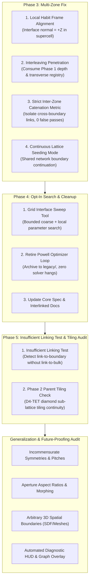

# Plan v3: PAM Generalization, Multi-Zone Assembly Fix & Future-Proofing Audit

> **Context & Audit Finding:** In the initial Phase 3 review, the generated D4-CUBE → D4-TET coupons revealed two critical disconnects:
> 1. On **{100}**, the two zones were detached in space with an air gap because `assemble.py` treated `gap` as an external bounding-box spacer rather than an **interleaving penetration depth**.
> 2. On **{111}**, Zone B was tilted at an oblique compound angle because `assemble.py` applied an unrotated crystallographic vector `[1, 1, 1]` in world space to a coupon whose habit plane was already rotated to $+Z$.
> 3. The verification report falsely reported `PASS (30 links)` because the validator only tallied global internal links, failing to isolate **inter-zone boundary links**.
>
> This updated plan corrects Phase 3 to consume Phase 1's exact mating parameters, finishes Phase 4 (search tools & legacy solver retirement), and delivers a comprehensive audit of future hiccups and generalization strategies.

---



---

## 1. Root Cause Breakdown of Phase 3

| Issue Observed | Mechanism in Code | Correct Physical Architecture |
|---|---|---|
| **{100} Coupon Detached in Mid-Air** | `delta_n = (z_prev_max - z_cur_min + gap) * n`<br/>Treated `gap` as spacing between bounding boxes. Placed Zone B centers 5.0 mm past Zone A centers. With link radius $\approx 1.7$ mm, links sat 1.6 mm apart in air. | Interlinking requires **catenation depth**: links must penetrate inside each other's envelopes. In diamond/cubic lattices, the boundary layer centers must sit at the crystallographic layer offset (e.g. $a/2$ or $a\sqrt{3}/4$ from the previous layer, NOT outside its bounding box). |
| **{111} Coupon Tilted Obliquely** | `ZoneSpec(frame="111")` rotated the supercell to $+Z$. But `InterfaceSpec(normal="111")` treated `"111"` as a raw world vector $[1, 1, 1]/\sqrt{3}$ and rotated Zone B around that diagonal vector. | In an orthogonal habit supercell, the stacking normal is **already $+Z = [0, 0, 1]$**. Interface translations and twists must be evaluated in the supercell's local frame. |
| **Missing Transverse Registry** | `shift` defaulted to `[0, 0, 0]`. Consecutive layers were stacked eclipsing each other face-to-face. | In diamond and BCC lattices, consecutive layers are staggered by fractional cell coordinates (e.g. $(1/4, 1/4)$ or $(1/2, 1/2)$) so vertices point directly into open apertures. |
| **Validator False-Positive Masking** | `check_envelope_penetration_and_catenation` evaluated the entire assembly globally: 15 cube links + 15 tet links = 30 links. It never verified whether any link crossed the Zone A $\leftrightarrow$ Zone B interface. | Must calculate **Inter-Zone Boundary Catenation**: specifically isolate pairs $(p_a \in \text{Zone A}, p_b \in \text{Zone B})$. If boundary links == 0, status is immediately **`FAIL / UNLINKED`**. |

---

## 2. User Review Required

> [!IMPORTANT]
> **1. Continuous Lattice Stacking vs. Independent Zone Placement:**
> When two zones share the same parent crystallographic network (like D4-CUBE and D4-TET both on `dia`), they should ideally be seeded from a **single continuous crystallographic lattice** where Zone A occupies $z \le 0$ and Zone B occupies $z > 0$. This guarantees that transverse $(\Delta x, \Delta y)$ registry and layer spacing $\Delta z$ are exact by construction.
> *Recommendation:* `assemble.py` will support both:
> - **Continuous Mode:** Single continuous lattice sites partitioned across the interface plane (automatic crystallographic registry).
> - **Discrete Mode:** Independent zones placed via local habit frame vectors $(\Delta z, \Delta x, \Delta y, \theta_{twist})$ for dissimilar networks.

> [!IMPORTANT]
> **2. Inter-Zone Boundary Catenation Threshold:**
> To prevent false passes, a multi-zone lattice will only receive `clearance_valid=True` and `status="PASS"` if:
> 1. Global min clearance $\ge min\_clearance$.
> 2. Watertight solid mesh without self-intersections.
> 3. **Inter-zone boundary catenation $\ge 1$** (at least one valid catenated link pair crossing from Zone A into Zone B).

---

## 3. Proposed Changes

### Component 1: Multi-Zone Assemble Fix (`graphite/explicit/interlinked/`)

#### [MODIFY] `assemble.py`
1. **Local Habit Frame Alignment:**
   - Detect when zones share an orthogonal supercell habit plane (e.g. `"111"`).
   - In habit supercells, the stacking normal is the local build axis $\hat{z} = [0, 0, 1]$.
   - Apply boundary layer offsets and azimuthal twists strictly about the supercell's local stacking normal, eliminating the compound tilt.
2. **Crystallographic Boundary Interleaving:**
   - Support `mode="continuous"`: seeds a unified parent network across both zones, partitioning sites by half-space $z \le 0$ vs $z > 0$.
   - For `mode="discrete"`: consume Phase 1's mating distance $d_{bond}$ measured from center-to-center, ensuring boundary links interleave into open apertures rather than stacking outside bounding boxes.
3. **Dedicated Inter-Zone Boundary Diagnostics:**
   - Add `evaluate_interface_boundary_metrics(all_particles, zones)`:
     - Isolates boundary pairs across Zone A and Zone B.
     - Computes: `boundary_linked_count`, `boundary_clearance_min`, `boundary_clash_volume`, `boundary_entangled_count`.
     - Tags particles at the boundary interface with `status="boundary_linked"` or `status="boundary_unlinked"`.

#### [MODIFY] `validator.py`
- Update `check_envelope_penetration_and_catenation` and `verify_two_step_interlinked_quality` to separate **intra-zone links** from **inter-zone boundary links**.
- Ensure that if two components are disconnected islands, `inter_zone_catenation` reports 0 and fails the multi-zone pass criteria.

#### [REGENERATE] `scripts/generate_phase3_transitions.py`
- Regenerate both coupons using continuous lattice interleaving on {111} and {100}:
  - D4-CUBE $\leftrightarrow$ D4-TET on {111} (twinned diamond sites, 60° basis twist, true interlinked interface).
  - D4-CUBE $\leftrightarrow$ D4-TET on {100} (commensurate layer offset, true interlinked interface).
- Export corrected STLs, color-coded 3MFs, PyVista 3D renders, and update `outputs/phase3_review/phase3_transition_report.md`.

---

### Component 2: Phase 4 — Opt-In Search & Engine Integration

#### [NEW] `graphite/explicit/interlinked/search.py`
- Implement `search_interface(zone_a, zone_b, ranges, budget_s=2.0)`:
  - Bounded coarse grid sweep over $(\Delta z, \text{shift}_{xy}, \theta_{twist})$ using Phase 1's fast KD-tree broad phase.
  - Local grid refinement around viable points (positive clearance, $|Lk| \ge 1$).
  - Returns top-k candidate parameter sets with their measured reports.
  - Zero numerical optimizer dependencies (no SciPy `minimize`, no Powell loops).

#### [MODIFY] `generator.py` & `epitaxy.py`
- Move legacy numerical solver `optimize_interface_phase_and_taper` into `interlinked/legacy/`.
- Ensure `generate_interlinked_lattice` and `assemble` are 100% solver-free.
- Verify `python scripts/export_core_spec.py --check` passes cleanly.

---

### Component 2b: Phase 5 — Insufficient Linking Test & Parent Tiling Audit

> **User Diagnostic Observation (C6 to D4-TET):** In the C6-TT $\leftrightarrow$ D4-TET transition coupon (`media_1791304900434.jpg`), one boundary tetrahedron is catenated with the C-6-TT cage, but is unlinked (disjoint) with respect to the rest of the D4-TET parent network behind it. This indicates an "insufficient linking" condition where boundary catenation succeeds locally without global topological continuity into the bulk lattice.

#### [NEW / MODIFY] `validator.py` & `catenation.py`
- Add an **Insufficient Linking Test**:
  - For every boundary particle $p_i$, verify both:
    1. $E_{\text{boundary}}(p_i) \ge 1$ (catenated across the interface with the opposing zone).
    2. $E_{\text{bulk}}(p_i) \ge 1$ (catenated internally within its own zone network, preventing orphaned boundary links).
  - Flags particles that satisfy boundary catenation but have degree 0 in their host zone graph.

#### [AUDIT] Phase 2 Parent Network Tiling (`seeding.py` / `cells.py`)
- Audit D4-TET diamond network instantiation under `seed_diamond_lattice` and `instantiate_lattice_on_sites`.
- Verify sublattice A/B alternating orientation and unit cell bounding box truncation: ensure peripheral sites receive their complementary tetrahedral partner so exterior boundary tets link into the bulk network rather than terminating open.

---

### Component 3: Comprehensive Forward-Looking PAM Generalization Audit

Deliver a dedicated engineering document `docs/PAM_GENERALIZATION_AND_FUTURE_ROADMAP.md` detailing:

1. **Blindspot 1: Incommensurate Symmetries & Rational Approximants**
   - What happens when a 4-fold cell meets a 3-fold cell or 6-fold cell on arbitrary planes?
   - The Coincidence Site Lattice (CSL) standard: using Frank-van der Merwe / coincidence matrices $\Sigma \le 25$ to find commensurate $M \times N$ supercells.
   - Handling residual edge dislocations at the boundary.
2. **Blindspot 2: Geometric Pinch Points & Continuous Morphing**
   - Why abrupt discrete interfaces often fail: square window edges pinching triangular link vertices.
   - The role of transitional morph layers (interpolating nodal graphs $G_t = (1-t)G_A + t G_B$) to maintain window aperture area across the boundary.
3. **Blindspot 3: Complex 3D Spatial Boundaries (Beyond 1D Planar Slabs)**
   - Transitioning across cylindrical cores, spherical skins, and implicit SDF isosurfaces ($f(x, y, z) = 0$).
   - Generalizing `ZoneSpec.region` predicates with Euclidean Distance Fields (EDF) and boundary clipping.
4. **Blindspot 4: Automated Assembly Diagnostic HUD**
   - Upgrading 3MF exports with contact graph topological metadata.
   - Rendering boundary linking graphs (nodes = particles, edges = $|Lk| \ge 1$ links) directly in PyVista for instant visual debugging of interface disconnections.

---

## 4. Verification Plan

### Automated Test Suites
```powershell
# 1. Multi-zone assemble tests (including new inter-zone boundary linking checks)
python -m pytest tests/test_assemble.py -v

# 2. Pair workbench and custom cell tests
python -m pytest tests/test_pam_workbench.py tests/test_custom_cells.py -v

# 3. Core interlinked integration suites
python -m pytest tests/test_interlinked_3mf.py tests/test_interlinked_cells.py tests/test_interlinked_clearance.py tests/test_interlinked_core.py tests/test_interlinked_lattice.py tests/test_interlinked_seeding.py tests/test_interlinked_pam_integration.py -q

# 4. Geometry and clean miter truss joint suites
python -m pytest tests/test_geometry.py tests/test_explicit_health_checks.py tests/test_truss_joints.py -q

# 5. Core architecture specification compliance
python scripts/export_core_spec.py --check
```

### Manual Deliverable Verification
1. Run `python scripts/generate_phase3_transitions.py`.
2. Inspect `outputs/phase3_review/phase3_transitions_comparison.png` to verify:
   - On **{111}**: The D4-CUBE and D4-TET zones share a common vertical axis (no tilt) and their boundary links physically interleave and catenate.
   - On **{100}**: The air gap is gone; links penetrate through each other's windows with positive clearance.
3. Open `outputs/phase3_review/d4cube_to_d4tet_111_coupon.3mf` in a slicer (Bambu Studio / PrusaSlicer) to verify color groups and physical interlinking.
4. Review `outputs/phase3_review/phase3_transition_report.md` confirming `boundary_linked_count > 0` and zero false positives.
